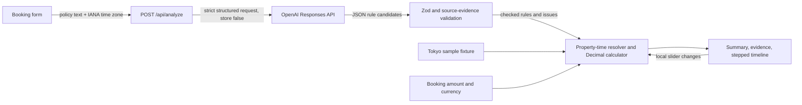

# Architecture

RefundCurve is a single-page Next.js App Router app. The browser owns booking details and display state. A single server route sends only the pasted cancellation policy and property time zone to OpenAI for structured extraction. Validated policy rules then flow through deterministic date and money calculations in the browser.

## Request and data flow

1. `src/app/page.tsx` renders the `PolicyWorkspace` client component.
2. `BookingForm` validates the amount, currency, required property time zone, optional check-in time, and pasted text. The amount and currency stay in the browser.
3. The Tokyo sample is a local, prevalidated fixture. It makes no AI request and works without credentials.
4. Live analysis sends `{ policyText, propertyTimeZone }` to the same-origin `/api/analyze` route. The handler limits the streamed body to 100,000 bytes and limits policy text to 15,000 characters, validates the JSON and IANA time zone, and checks that each proposed quote occurs exactly in the submitted text.
5. The server also checks that dates, times, penalty percentages, penalty consequences, and explicit time-zone evidence agree with the source excerpt. Invalid or unsupported candidates become unresolved issues.
6. `resolvePropertyTime` uses Luxon and rejects invalid, nonexistent, or ambiguous local times. `resolveRules` rejects conflicting or decreasing penalty schedules. `Decimal` computes penalties and refunds using the selected currency's minor-unit precision.
7. The browser renders the estimate, next deadline, source excerpts, and SVG timeline. Moving the native range control recalculates locally and never calls the model again.

## Components

| Component | Responsibility |
|---|---|
| `src/app/api/analyze/route.ts` | Node.js route; reads server-only configuration and calls the analysis handler. |
| `src/lib/ai/analyze-handler.ts` | Bounds and validates requests, handles provider failures, validates output, and verifies quote and rule evidence. |
| `src/lib/ai/extract-policy.ts` | Calls the fixed OpenAI Responses API endpoint with a strict JSON schema, `store: false`, request cancellation, and a 30-second timeout. |
| `src/lib/ai/prompt.ts` | Treats pasted policy as untrusted source material and directs extraction to leave unsupported rules unresolved. |
| `src/lib/ai/schema.ts` | Zod request/response contracts and provider JSON schema. Provider issues are capped at 40; the validated combined response allows up to 60 after per-rule issues are added. |
| `src/lib/ai/validate-analysis.ts` | Cross-checks model values against the exact quoted evidence. |
| `src/lib/dates/property-time.ts` | Resolves and formats property-local deadlines using IANA zones. |
| `src/lib/calculations/evaluate-policy.ts` and `money.ts` | Checks supported schedules and computes decimal-safe financial outcomes. |
| `src/components/policy-workspace.tsx` | Owns live/sample state and the analysis request lifecycle. |
| `src/components/financial-summary.tsx`, `policy-evidence.tsx`, `timeline-chart.tsx` | Presents the result, source text, and accessible timeline. |

There is no database, authentication, background worker, booking-platform integration, or persistent user data. Closing the page clears booking state.

## Configuration and services

- `OPENAI_API_KEY` is read only in the server route and is not included in client code or API requests from the browser.
- `OPENAI_MODEL` optionally selects a model; the default is `gpt-5.6-luna`, which supports the Responses API and structured outputs according to the [official model page](https://developers.openai.com/api/docs/models/gpt-5.6-luna).
- `NODE_USE_ENV_PROXY=1` is documented for managed workspaces that need the injected HTTP proxy.
- Live requests set `store: false`. This disables response-state storage but does not disable default abuse monitoring. OpenAI states that abuse-monitoring logs may retain prompts and responses for up to 30 days in its [data controls documentation](https://developers.openai.com/api/docs/guides/your-data). The form discloses this and asks users to remove personal details.
- Live extraction currently cannot complete because the configured account returned `credit_balance_exhausted`; a successful live result remains unverified.

## Security and reliability

- Pasted policy text is untrusted model input. The prompt says to ignore embedded instructions, the provider must return a strict schema, and server-side checks verify values against verbatim source excerpts.
- No SQL, shell, URL fetch, HTML injection, or file upload path accepts policy text. React renders extracted strings as text.
- The API request does not include booking amount or currency. The handler does not log policy contents and returns sanitized provider errors.
- `.env*` files are ignored except the blank `.env.example`. A tracked-file secret-pattern scan returned no matches.
- `npm audit --omit=dev` found zero production dependency vulnerabilities. The full audit reports one high advisory in development-only ESLint tooling (`braces` via `micromatch`/`fast-glob`); npm reports no fix.
- There is no shared rate limiter. Do not expose the unauthenticated analysis route publicly with a funded API key until shared usage controls are added. There is no production host or deployment configuration in this repository.

## Running and deployment

See [README.md](README.md) for local setup and checks. A public hosted website is not required by the verified hackathon rules, so no deployment was attempted or claimed.
