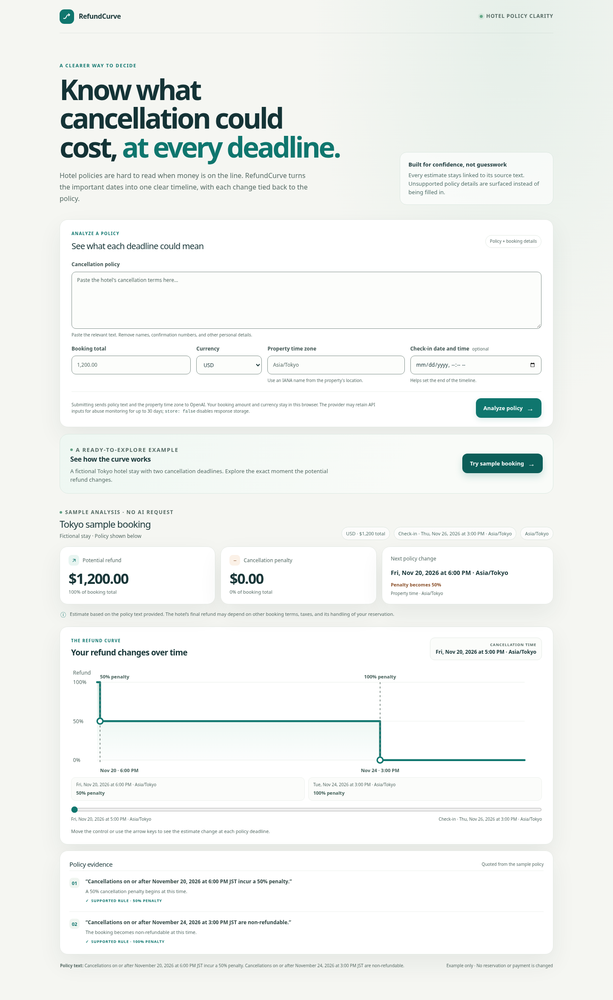

# RefundCurve

RefundCurve is a small web app for exploring how a hotel cancellation policy can change a traveler's potential refund. It shows supported deadlines on a time-zone-aware timeline and links each rule to an exact policy excerpt. The estimate is not a guarantee of a hotel refund or a legal interpretation.



The sample is fictional and works without an API request. Live analysis requires an OpenAI API key with available usage credits; API calls may incur charges.

## Run locally

Requirements: Node.js 20.9 or newer and npm.

```sh
npm ci
cp .env.example .env.local
```

For live policy analysis, add your OpenAI API key to `.env.local`. Keep it server-side and do not commit or share it. The model can be changed with `OPENAI_MODEL`; the default is `gpt-5.6-luna`. In managed workspaces that route traffic through a proxy, start the app with `NODE_USE_ENV_PROXY=1 npm run dev` so the server-side OpenAI request uses the configured proxy and TLS trust.

```sh
npm run dev
```

Open <http://localhost:3000>. The Tokyo example works without credentials. Live analysis sends only pasted policy text and the property's IANA time zone to OpenAI. The booking amount and currency remain in the browser. Requests set `store: false`, which disables response storage; OpenAI may retain API inputs for abuse monitoring for up to 30 days. Avoid including names, confirmation numbers, or other personal details in policy text.

## Supported behavior

The first version calculates explicit local date-and-time cancellation thresholds with percentage penalties, including a clearly stated whole-booking non-refundable deadline. It leaves relative deadlines, missing years or times, ambiguous or unsupported time-zone abbreviations, daylight-saving ambiguities, deadlines after a supplied check-in, conflicting or unlinked penalties, refund percentages, fixed fees, partial-night or per-room terms, taxes, and other unsupported rules unresolved. It does not save bookings, contact a hotel, or cancel a reservation.

The app runs locally and has no public hosting or shared API-key rate limiter. Before deploying it with a server-side OpenAI key to the public internet, add abuse and usage controls for the analysis endpoint. The official hackathon rules require a runnable project, a public source repository, and a demonstration video; they do not require a public website deployment. See [HACKATHON_COMPLIANCE.md](HACKATHON_COMPLIANCE.md).

## Checks

```sh
npm run lint
npm run typecheck
npm run test:unit
npm run test:integration
npm run test:e2e
npm run build
```

The integration tests mock OpenAI and do not need an API key. Playwright uses Chromium; set `PLAYWRIGHT_CHROMIUM_EXECUTABLE_PATH` if Chromium is installed somewhere other than `/usr/bin/chromium`.

## Project and submission documents

- [Architecture](ARCHITECTURE.md)
- [Hackathon compliance matrix](HACKATHON_COMPLIANCE.md)
- [Implementation plan and remaining blockers](IMPLEMENTATION_PLAN.md)
- [Test report](TEST_REPORT.md)
- [Devpost submission draft](SUBMISSION.md)
- [Final video plan](DEMO_VIDEO_PLAN.md) — planning only; record the video after every other item is complete.

## Demo outline

1. Open the Tokyo example and move the timeline across both cancellation deadlines.
2. Submit a fictional policy with two explicit percentage thresholds and inspect the quoted excerpts and calculated timeline.
3. Submit a relative or incomplete deadline and confirm that RefundCurve explains the missing detail without showing a guessed amount.

For the final narrated recording, install `devpost/requirements-demo.txt` into a temporary target with `python3 -m pip install --upgrade --target /tmp/refundcurve-demo-python -r devpost/requirements-demo.txt`. The recorder uses Playwright's ffmpeg helper when installed and falls back to `/usr/bin/ffmpeg` on Linux; elsewhere, install it with `npx playwright install ffmpeg`. Start the app with `NODE_USE_ENV_PROXY=1 npm run dev`, then run `PYTHONPATH=/tmp/refundcurve-demo-python npm run demo:live` in another terminal. This performs two live analyses using fictional details and checks both the supported timeline and unresolved ambiguous case before replacing `devpost/assets/refundcurve-demo-narrated.mp4`. Run this only as the final project task, after a funded OpenAI API account and all other checks are ready. The recording uses synthetic narration; review it before uploading. Keep the app local and avoid showing `.env.local`, API keys, or personal booking information. See [DEMO_VIDEO_PLAN.md](DEMO_VIDEO_PLAN.md).

## License

MIT. See [LICENSE](./LICENSE).
