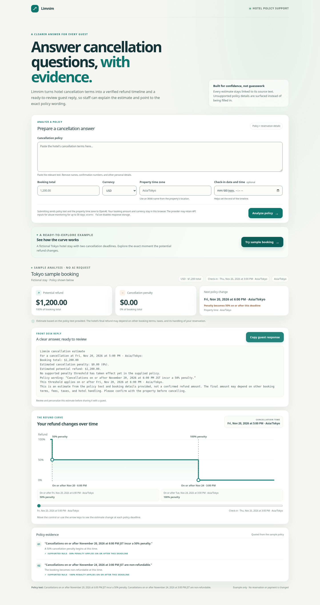

# Limnim

Limnim helps hotel teams answer cancellation questions with a clear estimate, the exact policy wording behind it, and a guest reply they can review and copy. AI extracts explicit cancellation thresholds; the app checks them against the submitted text and calculates amounts locally. The estimate is not a confirmed hotel refund or a legal interpretation.



The sample is fictional and works without an API request. Live analysis requires an OpenAI API key with available usage credits; API calls may incur charges.

## Run locally

Requirements: Node.js 20.9 or newer and npm.

```sh
npm ci
cp .env.example .env.local
```

For live policy analysis, add your OpenAI API key to `.env.local`. Keep it server-side and do not commit or share it. The model can be changed with `OPENAI_MODEL`; the default is `gpt-5.6-luna`. In managed workspaces that route traffic through a proxy, start the app with `NODE_USE_ENV_PROXY=1 npm run dev` so the server-side OpenAI request uses the configured proxy and TLS trust.

```sh
npm run dev
```

Open <http://localhost:3000>. The Tokyo example works without credentials. Live analysis sends only pasted policy text and the property's IANA time zone to OpenAI. The booking amount and currency remain in the browser. Requests set `store: false`, which disables response storage; OpenAI may retain API inputs for abuse monitoring for up to 30 days. Avoid including names, confirmation numbers, or other personal details in policy text.

## Hotel staff workflow

For a supported live policy, Limnim provides a deterministic guest-response draft with the selected property-local cancellation time, estimated penalty and refund, the relevant verbatim policy quote, and a clear estimate disclaimer. Staff can copy the response, review it, and send it through their existing channel. Limnim does not message guests or connect to a PMS. The Tokyo sample shows the same response composer using fictional data without an API request.

Of the broader hotel-operations ideas, this version focuses on repetitive cancellation questions: it gives the front desk a ready-to-review, evidence-linked answer. A later PMS integration could pair a resolved guest question with a hotel-approved paid option such as late checkout, but only after confirming the property's rules, availability, and price. Limnim does not sell or book services today. Mobile keys and identity checks, room upgrades, housekeeping dispatch, and bookable hotel amenities are larger workflows with separate data and system requirements, so they remain later product directions.

## Supported behavior

The first version calculates explicit local date-and-time cancellation thresholds with percentage penalties, including whether a penalty applies at the exact deadline (`on or after`) or only strictly later (`after`). It leaves unclear boundaries, relative deadlines, missing years or times, ambiguous or unsupported time-zone abbreviations, daylight-saving ambiguities, deadlines after a supplied check-in, conflicting or unlinked penalties, refund percentages, fixed fees, partial-night or per-room terms, taxes, and other unsupported rules unresolved. It does not save bookings, contact a hotel, send messages, or cancel a reservation.

The app runs locally and has no public hosting or shared API-key rate limiter. Before deploying it with a server-side OpenAI key to the public internet, add abuse and usage controls for the analysis endpoint. The official hackathon rules require a runnable project, a public source repository, and a demonstration video; they do not require a public website deployment. See [HACKATHON_COMPLIANCE.md](HACKATHON_COMPLIANCE.md).

## Checks

```sh
npm run lint
npm run typecheck
npm run test:unit
npm run test:integration
npm run test:e2e
npm run build
```

The integration tests mock OpenAI and do not need an API key. Playwright uses Chromium; set `PLAYWRIGHT_CHROMIUM_EXECUTABLE_PATH` if Chromium is installed somewhere other than `/usr/bin/chromium`. Set `PLAYWRIGHT_TEST_PORT` if port 3000 is already in use.

## Project and submission documents

- [Architecture](ARCHITECTURE.md)
- [Hackathon compliance matrix](HACKATHON_COMPLIANCE.md)
- [Implementation plan and remaining blockers](IMPLEMENTATION_PLAN.md)
- [Test report](TEST_REPORT.md)
- [Devpost submission draft](SUBMISSION.md)
- [Final video plan](DEMO_VIDEO_PLAN.md) — planning only; record the video after every other item is complete.

## Demo outline

1. Open the Tokyo example and review the ready-to-copy staff response and supporting policy text.
2. Submit a fictional policy with explicit percentage thresholds, review the guest response, then move the timeline across both deadlines.
3. Submit a relative or incomplete deadline and confirm that Limnim explains the missing detail without showing a guessed amount or response.

For the final narrated recording, install `devpost/requirements-demo.txt` into a temporary target with `python3 -m pip install --upgrade --target /tmp/limnim-demo-python -r devpost/requirements-demo.txt`. The recorder uses Playwright's ffmpeg helper when installed and falls back to `/usr/bin/ffmpeg` on Linux; elsewhere, install it with `npx playwright install ffmpeg`. Start the app with `NODE_USE_ENV_PROXY=1 npm run dev`, then run `PYTHONPATH=/tmp/limnim-demo-python npm run demo:live` in another terminal. This performs two live analyses using fictional details and checks both the supported timeline and unresolved ambiguous case before replacing `devpost/assets/limnim-demo-narrated.mp4`. Run this only as the final project task, after a funded OpenAI API account and all other checks are ready. The recording uses synthetic narration; review it before uploading. Keep the app local and avoid showing `.env.local`, API keys, or personal booking information. See [DEMO_VIDEO_PLAN.md](DEMO_VIDEO_PLAN.md).

## License

MIT. See [LICENSE](./LICENSE).
